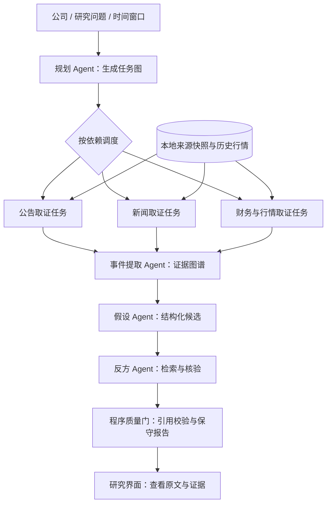

# 多Agent企业事件研究助手

一个基于大语言模型的 A 股企业事件研究原型，将公告、财务资料与新闻整理为可回查原文的事件时间线，并通过候选解释和反方核验辅助研究。

输入公司、研究问题和时间窗口，系统会规划取证任务、检索本地资料、构建事件证据图谱，并展示候选解释的支持与反对证据。项目重点是多 Agent 分工、编排、可追溯输出和有界失败处理。

## 核心功能

- **任务规划与并行取证**：模型拆解研究问题，按任务依赖调用白名单工具，读取资料与历史行情上下文。
- **可追溯资料检索**：保存来源元数据、原文快照和切片，支持去重及截止日期过滤。
- **事件时间线与证据图谱**：整理事件、主张和引用，区分资料发布日期与事件发生日，标记日期不明和数值冲突。
- **候选解释与反方核验**：提出竞争性解释，检索反证，通过证据卡展示模型选择的支持或反对原文。
- **研究过程可查看**：React 页面展示任务计划、阶段状态、工具轨迹、原文和报告；运行记录持久化，刷新页面不会重新调用模型。
- **调用与费用控制**：模型写入接口需要鉴权，支持费用估算上限与失败降级；服务重启后标记中断，不自动续跑付费任务。

## 工作流程



模型负责研究路径、事件归组和候选解释；Python 负责主体、日期、工具、依赖、预算和引用位置等约束。引用可以定位到原文，但证据是否真正支持某个解释仍需研究者判断。

## 快速体验

推荐先运行随仓库提供的历史演示，无需配置模型密钥。需要 Python 3.11、Node.js 和 npm。

以下为 Windows PowerShell 命令：

```powershell
python -m venv .venv
.\.venv\Scripts\python.exe -m pip install -r requirements.lock
.\.venv\Scripts\python.exe scripts/start_event_demo.py
```

打开 [研究工作台](http://127.0.0.1:8000/research)，选择贵州茅台、中国平安或中芯国际，查看事件时间线、原文、候选证据及报告。

脚本会自动安装缺失的前端依赖并构建页面，首次安装依赖需要网络。演示使用固定历史摘录及保存结果，禁用模型调用，数据写入独立的 `output/event-phase6-demo/` 目录。它不包含完整来源库和原始规划轨迹。已构建前端时可加 `--skip-build`，更换端口可用 `--port 8006`。

## 配置与运行

如需使用自己的事件资料库并发起模型研究，先创建本机配置文件：

```powershell
Copy-Item .env.example .env
```

在 `.env` 中配置：

| 配置项 | 用途 |
| --- | --- |
| `EVENT_RESEARCH_DATABASE_PATH` | 事件来源资料库 |
| `EVENT_GRAPH_DATABASE_PATH` | 事件图谱结果库 |
| `EVENT_DEBATE_DATABASE_PATH` | 候选解释与报告库 |
| `LLM_ENABLED` | 设为 `true` 启用模型调用 |
| `LLM_API_KEY`、`LLM_BASE_URL`、`LLM_MODEL_ID` | 模型服务配置 |
| `EVENT_API_WRITE_KEY` | 自行设置的写入接口密钥 |

预算及模型单价配置见 [.env.example](.env.example)。`.env`、本地数据库和 `output/` 不纳入版本控制，密钥仅保存在本机。

启动服务：

```powershell
npm --prefix frontend ci
npm --prefix frontend run build
.\.venv\Scripts\python.exe -m uvicorn app.api.main:app --host 127.0.0.1 --port 8000
```

网页与 API 共用 8000 端口，接口说明见 [API 文档](http://127.0.0.1:8000/docs)。开发前端时可另开终端执行 `npm --prefix frontend run dev`，访问 [Vite 开发页面](http://127.0.0.1:5173/)。

新克隆仓库不包含完整事件资料库。正式研究前需准备来源数据：CLI 支持资料采集、检索、研究规划和时间线生成，可通过以下命令查看用法：

```powershell
.\.venv\Scripts\python.exe -m app.cli --help
```

资料采集会联网并写入来源库，网页研究读取本地资料。固定样本的准备方法见[资料层说明](docs/event_research_phase2_acceptance_2026-10-12.md)和[规划与取证说明](docs/event_research_phase3_acceptance_2026-10-12.md)。模型研究请求需要 `X-API-Key`，可能产生模型服务费用；只浏览已有结果不会触发模型调用。

## 技术栈与代码结构

后端使用 Python、FastAPI、Pydantic 和 SQLite；前端使用 React、TypeScript 和 Vite，通过 HTTP 客户端连接模型服务。

```text
app/
  agents/              研究规划、事件提取、候选解释与反方核验
  api/                 HTTP 接口与访问控制
  data/                来源采集与数据存储
  models/              研究契约和结构化数据模型
  reporting/           面向界面的保守报告
  evaluation/          历史评测工具（非当前展示主线）
frontend/              React 研究工作台
scripts/               演示、样本准备与验证工具
tests/                后端测试
evals/                历史评测用例与结果
docs/                 架构、评测与开发记录
```

## 适用范围

当前支持 `600519` 贵州茅台、`601318` 中国平安、`688981` 中芯国际，单次研究窗口不超过 30 天。采集和研究由用户主动触发，尚未覆盖实时全市场数据。

项目定位为展示多 Agent 工程能力的研究原型。候选解释关系尚未经过独立语义验收，系统对证据不足的结果保守降级；输出用于辅助资料研究，不作为已证实的市场因果或投资建议。项目不以单/多 Agent 准确率比较作为交付目标。

## 测试与更多文档

```powershell
.\.venv\Scripts\python.exe -m pytest -q
npm --prefix frontend test
npm --prefix frontend run build
```

- [系统架构](docs/event_research_architecture.md)
- [多 Agent 分工与面试演示](docs/event_research_multi_agent_showcase_2026-10-27.md)
- [项目范围与验证边界](docs/event_research_internship_scope_2026-10-27.md)
- [开发路线](docs/ai_native_event_research_roadmap.md)
- [项目审计与清理记录](docs/event_research_project_audit_2026-10-27.md)
- [历史对照实验记录](docs/event_research_phase6_acceptance_2026-10-23.md)（保留复现材料，不作为当前项目卖点）
