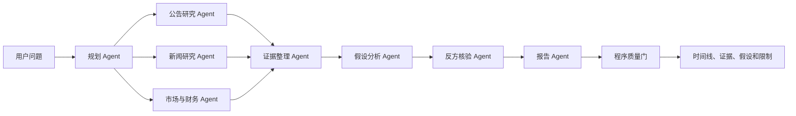

# AI 原生多 Agent 事件研究改造路线

更新日期：2026-10-12

## 1. 改造目标

在现有项目中增加“企业事件研究”主流程，使大模型负责传统规则难以完成的工作：动态拆题、选择工具、理解公告与新闻、构建事件时间线、提出竞争性假设、寻找反证并判断何时停止研究。

Python继续负责日期过滤、数值计算、来源去重、权限、预算上限和最终一致性检查。系统输出研究假设及其证据强弱，不输出确定的市场因果、价格预测或买卖建议。

第一版范围固定为：

- 研究对象：`600519` 贵州茅台、`601318` 中国平安、`688981` 中芯国际。
- 研究窗口：查询日之前30天。
- 来源：交易所或公司公告，以及2至3个可保存原文快照的新闻来源。
- 入口：用户在网页中主动发起研究或资料收集，不增加后台定时任务。
- 评测：至少20道人工标注问题，并保留单 Agent 与多 Agent 对照。

目标问题示例：

> 梳理某公司最近30天的重要事件。股价或成交变化可能与哪些事件有关？分别列出支持证据、反对证据和无法确认的部分。

## 2. 目标流程

模型可以决定研究步骤和工具调用，但不能绕过以下程序约束：研究对象白名单、截止日期、来源快照、最大步骤、最大Token、最大费用、引用存在性和未来信息隔离。

## 3. 分阶段实施

### 阶段一：定义研究契约和人工基准

**状态：已于2026-10-12完成并通过本地验收。** 结果见[阶段一验收记录](event_research_phase1_acceptance_2026-10-12.md)。基准题采用人工合成场景，真实来源采集仍属于阶段二。

**目的**：先定义“什么叫回答正确”，防止先堆Agent、最后无法评价。

实施内容：

1. 将研究输出定义为结构化对象：研究计划、事件、证据、假设、反证、最终判断、未知项和执行轨迹。
2. 建立20道人工问题，覆盖事件梳理、公告解读、跨来源冲突、候选原因、证据不足和未来信息泄漏。
3. 每道题人工标注必要事件、允许使用的截止日期、有效来源、禁止结论和期望回答状态。
4. 保存当前ETF流程的测试结果，作为改造前基线。

主要改动位置：

- `app/models/`：新增事件研究的数据模型。
- `evals/`：新增人工标注题和来源清单。
- `app/evaluation/`：增加事件级评分器。

验收条件：

- 20道题均有人工答案或评分规则。
- 能检查引用正确性、事件覆盖率、时间边界和无证据断言。
- 当前ETF测试在本阶段结束时仍能通过。

### 阶段二：建立可追溯的事件资料层

**目的**：让Agent有足够的非结构化资料可研究，并能回到原文核验。

实施内容：

1. 将现有ETF专用资料模型扩展为通用研究对象 `ResearchSubject`。
2. 新增公告、新闻和财务数据的用户触发式采集工具。
3. 每份资料保存原始URL、标题、发布者、发布时间、采集时间、正文快照和内容哈希。
4. 根据URL、标题、内容哈希和转载关系去重，避免把同一条新闻当成多份独立证据。
5. 查询时严格执行 `published_at <= as_of_date`，禁止未来资料进入报告。

主要改动位置：

- `app/data/`：研究对象、事件来源、快照和去重字段。
- `app/rag/`：正文切片、混合检索和元数据过滤。
- `app/tools/`：公告、新闻、行情与财务只读工具。

验收条件：

- 三家公司均有可复查的公告和新闻样本。
- 原文快照数量、切片数量和检索元数据一致。
- 重复资料不会被计为多条独立证据。
- 截止日期之后的资料不会出现在检索结果中。

### 阶段三：让模型真正控制研究计划

**目的**：让不同问题产生不同计划和工具路径，使AI成为核心能力。

实施内容：

1. 规划Agent输出带类型的任务图，而不是固定的“行情+资料”两个步骤。
2. 计划节点包含研究目标、所需工具、依赖节点、完成条件和失败降级方式。
3. 编排器按依赖执行任务，允许公告、新闻、市场和财务任务并行。
4. 增加最大轮次、工具白名单、参数校验、超时、Token和费用预算。
5. 记录模型为什么选择某个工具，以及停止研究的原因。

主要改动位置：

- `app/agents/llm_research.py`：逐步替换为通用编排器。
- `app/agents/`：规划、路由和并行执行模块。
- `app/tools/research_tools.py`：扩展统一工具注册表。

验收条件：

- 事件梳理、公告解读、财务变化和因果追问至少产生三类不同任务图。
- 非法工具、越界公司和未来日期被程序拒绝。
- 单个Agent失败时保留已取得证据，并明确降级状态。
- 关闭模型后无法完成开放式事件研究，只能保留基础数据查询。

### 阶段四：事件时间线和证据图谱

**目的**：把搜索结果变成可计算、可质疑的研究证据。

实施内容：

1. 证据整理Agent从资料中提取主体、事件、日期、数字、动作和原文引用。
2. 将“文档片段”“事实主张”“事件”“来源”分开存储。
3. 合并重复事件，标记不同来源之间的一致、冲突和引用关系。
4. 生成按发生日期排序的事件时间线，并区别事件发生时间与报道时间。
5. 数字事实交给Python重新计算或格式校验。

主要改动位置：

- `app/models/`：`Event`、`Claim`、`Evidence`、`Citation`。
- `app/data/repositories/`：证据与事件持久化。
- `frontend/src/`：时间线和证据抽屉。

验收条件：

- 每个重要事件至少能回到一个原文片段。
- 同一事件的重复报道可以合并查看。
- 冲突数字和冲突日期不会被静默覆盖。
- 页面能够显示“原文说了什么”和“系统据此提出什么主张”。

### 阶段五：竞争性假设和反方核验

**目的**：避免单个模型搜索到一条材料后直接下结论。

实施内容：

1. 假设Agent生成至多三个候选解释。
2. 每个假设必须分别列出支持证据、反对证据、缺失证据和替代解释。
3. 反方Agent主动寻找时间顺序错误、遗漏材料、来源依赖和过度因果推断。
4. 报告Agent根据核验结果生成结论等级：证据较强、存在关联、证据不足、无法判断。
5. 程序质量门检查所有引用、日期、数值和禁止表述；不通过时降级为部分回答。

主要改动位置：

- `app/agents/`：假设、反方和报告Agent。
- `app/models/research.py`：假设及核验结果。
- `app/reporting/`：时间线和假设对照报告。

验收条件：

- 因果问题不会只输出单一解释。
- 每个假设都有支持证据和反证字段。
- 没有足够证据时明确返回“无法确认”，不会补写原因。
- 报告中的每个关键事实均可追溯到数据记录或原文片段。

### 阶段六：React研究界面、对照评测和简历交付

**目的**：让用户看见AI做了什么，并用数据证明流程价值。

实施内容：

1. 将研究页改为“问题—计划—并行取证—假设—核验—报告”的可视流程。
2. 页面展示Agent状态、工具调用、证据来源、冲突项、Token、耗时和停止原因。
3. 保留规则查询、单Agent和多Agent三种方法用于对照，但主入口使用事件研究。
4. 对20道题重复运行，统计工具选择正确率、引用准确率、事件覆盖率、无依据断言率、未来信息泄漏、耗时和成本。
5. 人工逐题审核最终答案；自动分数只作为辅助证据。
6. 更新README、架构图、演示数据、运行脚本和简历表述。

主要改动位置：

- `frontend/src/pages/ResearchPage.tsx`：研究流程页面。
- `frontend/src/components/`：计划、时间线、证据、假设和核验组件。
- `scripts/`：三种方法对照评测。
- `docs/`：最终验收和演示说明。

验收条件：

- 用户能清楚区分模型判断、程序计算和原始证据。
- 20道题有逐题结果和人工审核记录。
- 多Agent相对单Agent的改善有指标支持；如果没有改善，如实记录。
- 完整演示可在一条命令启动，测试、构建和API健康检查通过。

## 4. 实施顺序和提交边界

每个阶段单独建立Git提交，只有上一阶段达到验收条件后才进入下一阶段：

1. `Define event research contracts and eval set`
2. `Add traceable event source pipeline`
3. `Add model directed research orchestration`
4. `Build event timeline and evidence graph`
5. `Add hypothesis debate and verification`
6. `Complete AI native research UI and evaluation`

如果某阶段发现真实来源不可稳定采集，先使用保存好的公开资料快照完成可重复评测，再单独解决联网采集问题，不能用演示数据证明真实数据已经可用。

## 5. 明确不做的内容

第一版不加入以下范围：

- 自动交易和券商接口。
- 股价涨跌预测或收益率承诺。
- 自动定时采集和后台常驻任务。
- 多用户权限、付费订阅和云端生产部署。
- 无限制自主浏览、无限工具循环或无人审核的高风险操作。

## 6. 最终项目定位

完成六个阶段后，项目可以准确描述为：

> 基于Python、FastAPI和React实现的大模型驱动多 Agent 企业事件研究系统。模型动态规划研究路径并并行调用公告、新闻、行情和财务工具，系统构建事件时间线与竞争性假设，通过反方Agent、引用核验、未来信息隔离和人工评测控制幻觉。

在六个阶段完成前，README和简历只能写已经通过验收的阶段，不把路线图中的能力写成现有功能。
