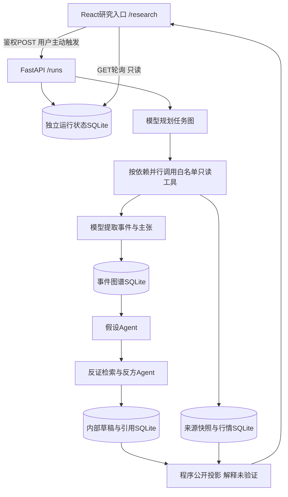

# 企业事件研究架构与交付说明

模型决定任务路径、事件归组、候选证据关系和核验方向；Python校验主体、日期、依赖、预算、引用位置与数值格式。公开图谱仍属于模型提取结果，原文才是核对依据。用户将人工语义验收移出本次实习范围，因此网页仅发布证据卡与程序生成的保守说明，明确标注解释关系未独立验证。

数据库相互独立，来源库只读，结果库追加/按运行保存。任务是单进程内用户请求，不运行定时采集。进程重启保留完成阶段并标记中断，不恢复付费调用。

## 演示顺序

1. 用 `scripts/start_event_demo.py` 启动固定历史回放，选择贵州茅台、中国平安或中芯国际。
2. 展开一个已知发生日事件和一个日期未知事件，区分发生日与资料发布日期。
3. 点击证据，查看原文、模型提取、数值重算或冲突记录。
4. 查看候选支持/反对组合、反方类别与保守报告。解释为何当前不能形成确定因果。
5. 展示任务依赖、并行取证与停止原因；说明假设和反方分别处理什么，以及程序如何在证据不足时降级。

演示包没有当时规划轨迹与耗时，页面不会补造这些信息。正式新运行才记录完整计划与执行状态。

## 可用于简历的已实现描述

> 使用 Python、FastAPI、SQLite 和 React 实现多 Agent 企业事件研究原型。规划模块生成带依赖的任务图并调度白名单工具并行取证，事件提取、结构化假设与反方核验分别处理证据整理和解释检查；持久化运行状态与可回查原文的证据卡，并通过日期、引用和费用边界及失败降级控制输出。

可以补充自动回归与三家公司历史回放的浏览器检查。不要宣称真实研究准确率已验证、已证明市场因果或人工语义验收通过。当前交付范围见[范围说明](event_research_internship_scope_2026-10-27.md)。
